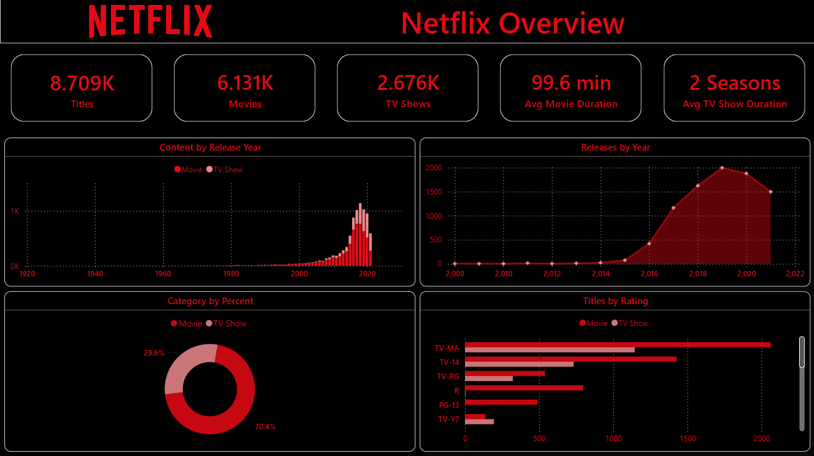
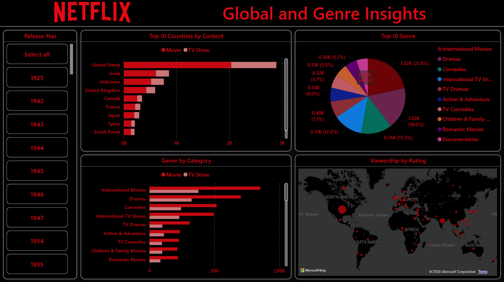
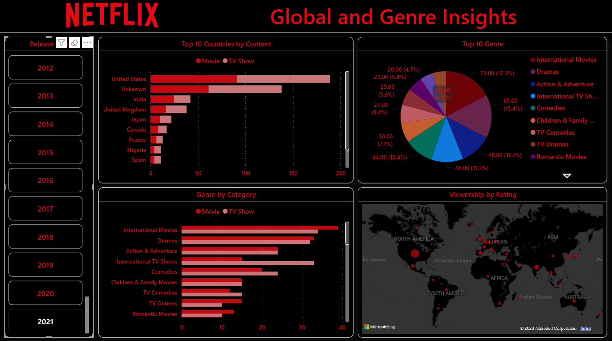
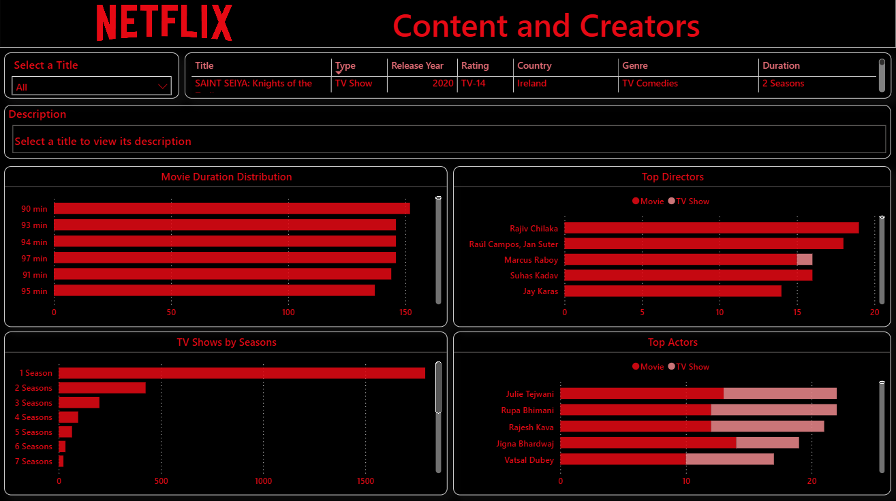
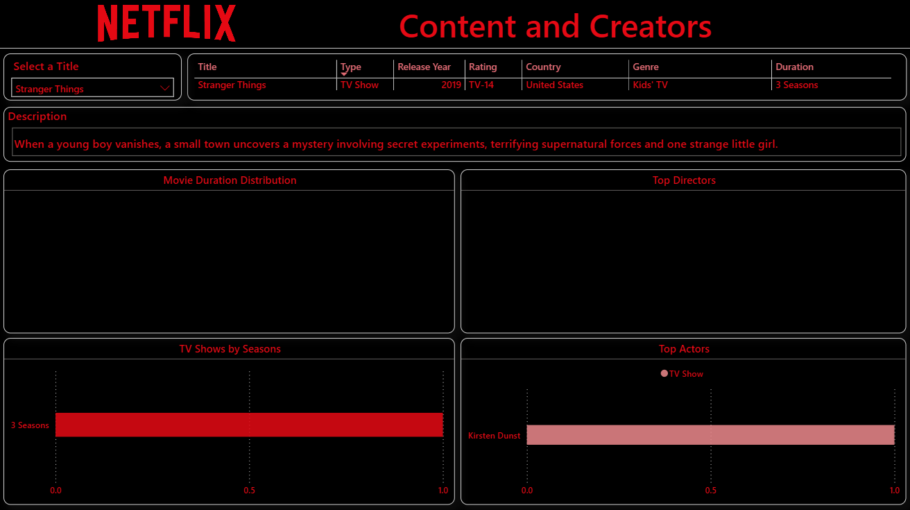

# Netflix Content Analysis

An end-to-end data analytics project that explores Netflix's content catalogue using Python, MySQL, and Power BI. The data was cleaned and analysed in a Jupyter Notebook, queried in MySQL, and presented through a 3-page interactive Power BI dashboard.

## Project Overview

This project answers questions such as:

- How large is the Netflix catalogue, and how is it split between movies and TV shows?
- Which release years, ratings, countries, and genres dominate?
- What do typical movie durations and TV show season counts look like?
- Who are the most frequent directors and actors?

## Tools & Technologies

- Python (Pandas, NumPy, Matplotlib, Seaborn)
- Jupyter Notebook
- MySQL
- Power BI

## Repository Structure

netflixContentAnalysis/
- netflix_data.csv 

## Workflow

1. Data inspection: Loaded the dataset in Python and checked shape, data types, missing values, and duplicates.
2. Data cleaning: Handled missing values (for example, an "Unknown" category for country), standardised formats, and split multi-value fields such as country, cast, and listed_in.
3. Exploratory analysis: Used Pandas and NumPy for aggregation, and Matplotlib for charts inside the notebook.
4. SQL analysis: Loaded the cleaned data into MySQL and wrote queries for counts, rankings, and category breakdowns.
5. Dashboarding: Built a 3-page Power BI dashboard with KPI cards, slicers, and interactive visuals.

## Dashboard Preview

### Page 1: Netflix Overview
KPI cards for total titles, movies, TV shows, average movie duration, and average TV show duration, plus release-year trends, category split, and titles by rating.

### Page 2: Global & Genre Insights

Top 10 countries by content, top 10 genres, genre by category (movie vs TV show), and a map view, with a release-year slicer.

### Page 3: Content & Creators

Title selector with details, movie duration distribution, TV shows by seasons, top directors, and top actors.

## Key Findings

- The dataset contains 8.709K total records, with movies making up about 70.4% of the catalogue and TV shows about 29.6%.
- 2018-2020 are the most represented release years, with 1,000+ titles, followed by a decline toward 2022.
- TV-MA is the most common rating with 1,800+ records, followed by TV-14, so the catalogue leans toward mature and teen audiences.
- The average movie runs 99.6 minutes, with most films between 90 and 97 minutes. Most TV shows are short-run, with 1 Season by far the most common.
- The United States leads all countries in content volume, and International Movies is the top genre (17.3% of the top 10 genres).

## Limitations

- Missing values and inconsistent formatting can affect the analysis.
- The catalogue dataset does not include viewership, revenue, or user engagement measures.
- Results depend on the dataset version and the cleaning choices made.

## How to Run

1. Clone the repository
bash:
   git clone https://github.com/<your-username>/netflix-content-analysis.git
   cd netflix-content-analysis
   
2. Install dependencies
bash:
   pip install pandas numpy matplotlib seaborn jupyter
   
3. Run the notebook
bash:
   jupyter notebook notebooks/netflix_analysis.ipynb
   
4. MySQL: Create a database, import the cleaned CSV, and run the queries in sql/netflix_analysis.sql.
   
5. Power BI: Open dashboard/Netflix_dashboard.pbix in Power BI Desktop.
